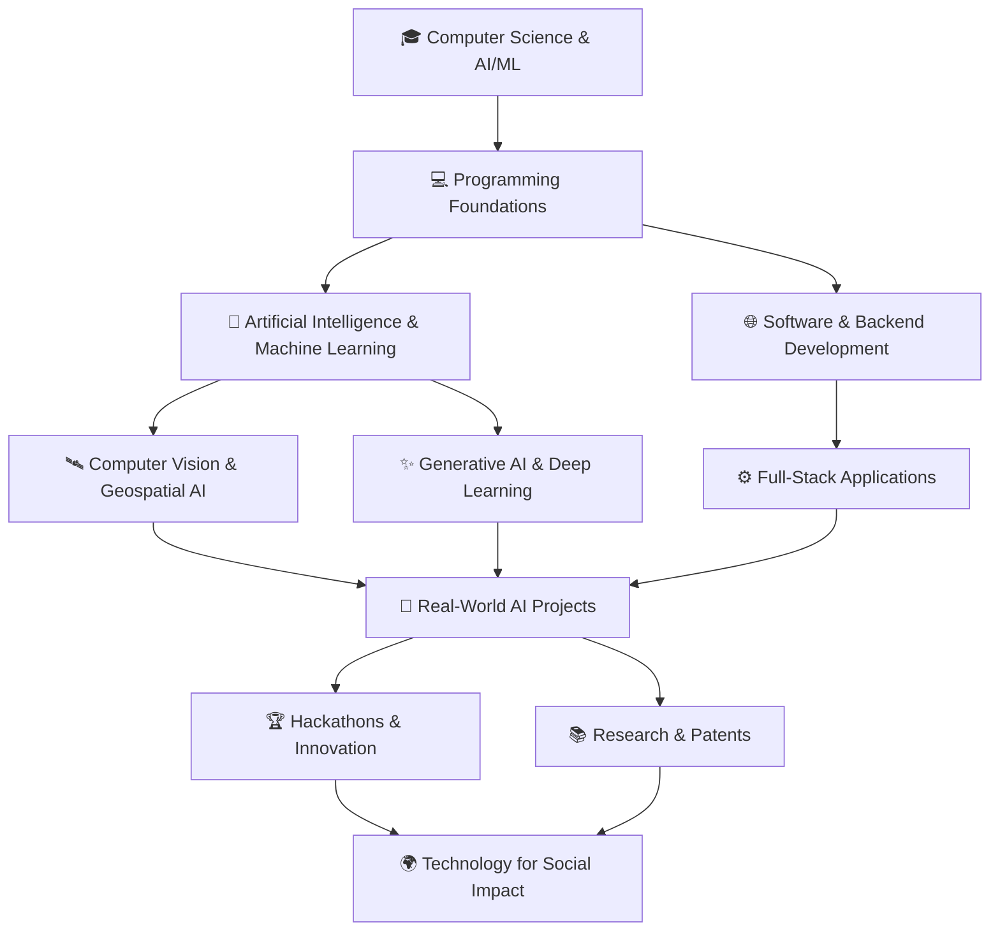
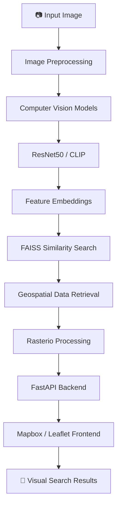
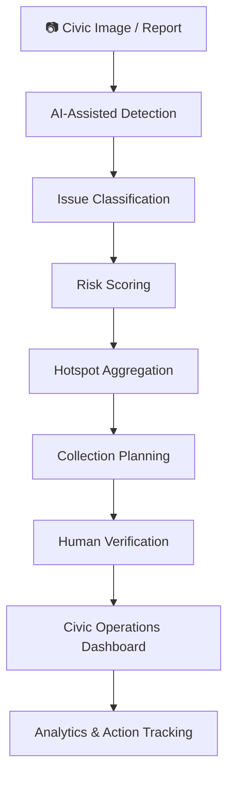

# Hey, I'm Anurag Prajapati 👋

### AI/ML Developer | Software Engineer | Research Enthusiast

> Building intelligent systems, engineering real-world solutions, and exploring the intersection of Artificial Intelligence and human impact.

I'm a Computer Science undergraduate specializing in **Artificial Intelligence & Machine Learning** at Chandigarh University.

I enjoy turning ideas into working products — from computer vision and geospatial intelligence to generative AI applications and smart civic technology.

- 🎓 B.Tech CSE (AI & ML), Chandigarh University — 2024–2028
- 🧠 Interested in Artificial Intelligence, Machine Learning, Computer Vision and Generative AI
- 🚀 Building AI-powered applications with real-world impact
- 🔬 Exploring applied AI research and innovation
- 🏆 Hackathon winner and national-level ideathon achiever
- 💡 Interested in research, patents, open-source development and problem-solving

---

## 🧭 My Developer Journey

---

## 🚀 Featured Projects

### 01. GeoVision AI
**Visual Search & Geolocation Intelligence System**

An AI-powered system designed to identify and locate relevant geographical regions using visual and satellite imagery.

- Image-based geographical search without requiring GPS coordinates.
- Computer vision using ResNet50 and CLIP.
- Similarity search using FAISS.
- Geospatial processing using Rasterio.
- Backend using Python and FastAPI.
- Interactive mapping with Mapbox / Leaflet.

**Tech:** Python · PyTorch · FastAPI · FAISS · Rasterio · CLIP · ResNet50

---

### 02. CivicLoop AI
**Predictive Waste Intelligence & Verified Civic Action Network**

An AI-powered smart waste management platform designed to improve civic issue detection, monitoring and response.

- AI-assisted civic issue detection.
- Explainable risk scoring and hotspot identification.
- Predictive collection planning.
- Evidence-based incident reporting and human-reviewed verification.
- Dashboard and analytics for civic operations.

**Tech:** Python · FastAPI · SQLite · Computer Vision · AI Analytics · Streamlit

---

### 03. Festora AI
**AI-Powered Event Planning Platform**

A generative AI application that helps users plan events through intelligent recommendations and automated planning.

- AI-generated event plans.
- Budget allocation and optimization.
- Venue and catering recommendations.
- Decoration themes and risk analysis.
- Invitation generation.
- Authentication and persistent storage.

**Tech:** Node.js · Express.js · Google Gemini API · SQLite · JavaScript

[GitHub Repository](https://github.com/AnuragPrajapati05/Festora-AI)

---

### 04. PulseCloth
**Wearable Health Monitoring System**

A wearable technology concept focused on monitoring health-related parameters through smart wearable integration.

**Focus:** Wearable Technology · Sensors · Health Monitoring · IoT

---

### 05. FasalSetu
**Agricultural Market Intelligence**

A project focused on agricultural market data integration and backend development.

- Government mandi data integration through Data.gov.in.
- Market, commodity, variety and grade mapping.
- Agricultural price data handling.
- Backend validation and database integration.

**Tech:** Node.js · Backend Development · MySQL · Data Integration

---

## 🏆 Achievements & Recognition

- 🥇 **1st Position** — ELEVATE X 2026, Chandigarh University, Team Code5urge.
- 🏆 **Top 20 National Ideathon** — Among 1.5 lakh+ participants.
- 🚀 **Shortlisted** — IIT Delhi AI Grand Challenge with GeoVision AI.
- 🔬 **Research & Innovation** — Contributions to patent filings and grant proposals.
- 🎓 **Campus Ambassador Intern** — HireDude, Chandigarh University.

---

## 🔬 Research & Innovation

I'm interested in developing AI solutions that address meaningful real-world problems.

**Research interests:**
- On-device and offline Generative AI.
- AI for accessibility and assistive technology.
- Computer Vision and Geospatial Intelligence.
- Energy-efficient AI training.
- AI for smart cities and social impact.

**Patent and innovation contributions:**
- Contributions to 9 patent filings.
- Involvement in 2 grant proposals.
- Exploring innovations in gesture-based interaction, energy-efficient AI and electricity-free lighting concepts.

**Research direction:**

Grounded On-Device Generative AI for Offline Scene Description to Support Visually Impaired Users.

---

## 🛠️ Tech Stack & Tools

### Programming Languages

### AI / ML / Data Science

### Backend & Frameworks

### Databases & Developer Tools

**Additional technologies:** FAISS · Rasterio · CLIP · ResNet50 · SQLAlchemy · Mapbox · Leaflet · Google Gemini API

---

## 🏗️ Project Architecture — GeoVision AI

## 🏙️ Project Architecture — CivicLoop AI

---

## 📊 GitHub Statistics

  
  

  

---

## 🌱 Currently Exploring

- Advanced Data Structures & Algorithms in Java.
- Applied Machine Learning and Deep Learning.
- Generative AI and LLM applications.
- Scalable backend systems.
- Research-driven AI development.

---

## 🤝 Let's Connect

I'm always interested in collaborating on innovative projects, AI research, open-source contributions and technology that creates social impact.

  
  

---

  <b>Building with curiosity. Innovating with purpose. Engineering for impact.</b>

  ⭐ If you find my work interesting, consider exploring my repositories!

